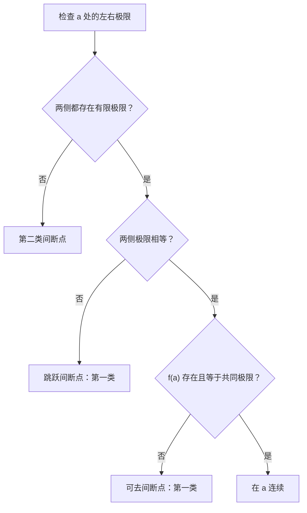

# 高数 Part 1｜函数（Functions）、极限（Limits）与连续（Continuity）知识主干

**推导与例题：** [[MATH-P1-Exercises]]。

## 复习总览：函数、极限与连续的三个问题

下表讨论内点 $x_0$；端点的连续性按相应单侧极限判断。

| 层次 | 要回答的问题 | 在内点 $x_0$ 的检查重点 |
|---|---|---|
| 函数 | 哪些输入允许？该点取什么值？ | 确定定义域 $D_f$；只有 $x_0\in D_f$ 才有 $f(x_0)$ |
| 极限 | 沿定义域靠近该点时，函数值趋向哪里？ | 在去心邻域看 $\lim_{x\to x_0}f(x)$；不直接使用 $f(x_0)$ |
| 连续 | 邻近趋势能否接上该点的取值？ | $x_0\in D_f$，且有限极限存在并等于 $f(x_0)$ |

这条线索用于区分三种常见判断：**函数值存在**只说明该点有取值；**极限存在**只说明邻近趋势稳定；**连续**要求两者接上。极限存在而该点无定义或取值不同，见本篇第 7.2 节的可去间断点；再进一步研究变化率时，进入 [[MATH-P2-Knowledge]] 的导数与微分。

## 1. 函数（Function）：先问哪些输入有意义

### 1.1 定义域（Domain）与复合函数（Composite Function）

写出 $y=x^2$ 还没有完整指定一个函数：还要知道允许哪些 $x$。函数（function）由**定义域（domain）**和“每个允许的输入对应唯一输出”的规则确定。因此，同一个解析式若规定了不同的定义域，就不能直接当作同一个函数。

复合函数（composite function）是先算内层 $g(x)$，再把结果交给外层 $f$。它的定义域须同时满足两道门槛：

$$
D_{f\circ g}=\{x\in D_g\mid g(x)\in D_f\}.
$$

这里 $D_g$ 是 $g$ 的定义域，$D_f$ 是 $f$ 的定义域。式子说明：先保证 $g(x)$ 能算，再保证算出的值能作为 $f$ 的输入。只知道内层值域与外层定义域有交集，还不能直接写出所有可取的 $x$。

**补充示例：** 若 $g(x)=x-2$，$f(u)=\sqrt u$，则要让内层输出进入外层定义域，必须有 $x-2\ge0$；所以 $f(g(x))=\sqrt{x-2}$ 的定义域是 $x\ge2$。

### 1.2 反函数（Inverse Function）与值域（Range）

反函数（inverse function）要把“由 $x$ 算 $y$”反过来，要求在**指定定义域**内每个输出只对应一个输入。若两个不同输入给出同一个输出，就无法从这个输出唯一找回原输入。

因此，原函数的值域（range）是反函数的定义域；原函数的定义域是反函数的值域。两幅图像关于 $y=x$ 对称。这个结论建立在原函数在所选定义域上一一对应的前提下。

**补充示例：** $f(x)=x^2$ 若以全体实数为定义域，$2$ 与 $-2$ 都对应 $4$，没有全局反函数；若限制为 $x\ge0$，就能由输出 $y\ge0$ 唯一找回 $x=\sqrt y$。

笔记列出幂函数（power function）、指数函数（exponential function）、对数函数（logarithmic function）、三角函数（trigonometric function）与反三角函数（inverse trigonometric function）。遇到反三角函数，要核对选取的单调区间与取值范围。

### 1.3 四类常见函数性质（Properties of Functions）

这些性质都是针对**指定定义域或区间**说的。换了讨论范围，判断可能改变。

| 性质 | 通俗检查 | 严谨条件或边界 |
|---|---|---|
| 单调性（monotonicity） | 输入变大时，输出朝哪个方向变 | 在指定区间比较 $x$ 与函数值的先后关系 |
| 奇偶性（parity） | 图像能否呈现相应对称性 | 定义域先关于原点对称，再检验 $f(-x)=f(x)$ 或 $f(-x)=-f(x)$ |
| 周期性（periodicity） | 平移一段后数值是否重复 | 存在 $T>0$，平移后函数仍有定义且 $f(x+T)=f(x)$ |
| 有界性（boundedness） | 输出能否被固定的上下界罩住 | 在指定集合上存在统一的上界与下界 |

## 2. 极限（Limit）：看靠近时的行为

极限（limit）问的是：输入越靠近指定位置，输出能否稳定靠近某个数。先认清研究对象是数列还是函数，再认清从哪个方向趋近。

### 2.1 数列极限（Limit of a Sequence）

数列极限（limit of a sequence）只要求**足够靠后的所有项**靠近 $A$；前面有限项怎样变化，不影响极限。写作 $a_n\to A$ 时，$a_n$ 是第 $n$ 项，$A$ 是候选极限。

严谨地说：对任意允许的误差 $\varepsilon>0$，总能找到序号 $N$，使每个 $n>N$ 都满足

$$
|a_n-A|<\varepsilon.
$$

这个 $\varepsilon$–$N$ 定义（epsilon–$N$ definition）强调“**所有**后续项”，不是只找到某一项碰巧接近 $A$。

### 2.2 函数极限（Limit of a Function）与去心邻域（Punctured Neighborhood）

函数极限（limit of a function）看的是**靠近 $x_0$ 时**的函数值，不直接看 $x_0$ 那一点。这里默认 $x_0$ 是定义域的聚点（accumulation point），即定义域内总能找到不同于 $x_0$、又任意靠近它的点。

若 $\lim_{x\to x_0}f(x)=A$，对任意 $\varepsilon>0$，可找到 $\delta>0$：只要 $x$ 在定义域内，且 $0<|x-x_0|<\delta$，就有

$$
|f(x)-A|<\varepsilon.
$$

$\delta$ 管输入离 $x_0$ 多近，$\varepsilon$ 管输出离 $A$ 多近。$0<|x-x_0|<\delta$ 描述去心邻域（punctured neighborhood）：它包含附近的点，却排除了中心 $x_0$。因此 $f(x_0)$ 是否有定义、取什么值，都不直接决定这个极限。

**补充示例：** $f(x)=(x^2-1)/(x-1)$ 在 $x=1$ 无定义；但当 $x\ne1$ 时，$f(x)=x+1$，所以 $\lim_{x\to1}f(x)=2$。中心点没有函数值，仍可讨论邻近点的极限。

在定义域内可从左右两侧任意靠近 $x_0$ 时，双侧极限（two-sided limit）存在且等于 $A$，当且仅当左极限与右极限（one-sided limits）都存在且都等于 $A$。分段、绝对值或含 $1/x$ 的式子，须分别检查两侧；例题见 [[MATH-P1-Exercises]]。

### 2.3 自变量趋于无穷（Limit at Infinity）

$x\to+\infty$ 看输入向右越走越远，$x\to-\infty$ 看向左越走越远。若题目说 $|x|\to\infty$，则两端都要检查；只算出其中一端，不能直接宣称双向结论。

## 3. 收敛（Convergence）会带来哪些限制

### 3.1 有界性（Boundedness）

收敛数列（convergent sequence）不可能在后面一直跑向任意远处；再把前面有限项也算进去，整个数列必有界。函数在有限点有有限极限时，只能推出它在该点附近的**去心邻域内局部有界（locally bounded）**；并不要求 $f(x_0)$ 有定义。

反过来，有界不保证极限存在。例如 $\sin(1/x)$ 在 $x\to0$ 时始终介于 $-1$ 和 $1$ 之间，却不断振荡（oscillation）；相关推演见 [[MATH-P1-Exercises]]。

### 3.2 正极限的保号性（Eventual Positivity）

若数列趋向一个**严格大于零**的数，走到足够后面，它就会一直为正。这是保号性（eventual positivity）：不是说每一项都为正，而是说从某项以后不再变号。

若 $a_n\to A>0$，可选 $0<c<A$，使足够大的 $n$ 满足 $a_n>c>0$。这里 $A$ 是正极限，$c$ 是预先选定的正下界；函数有有限正极限时，也有相应的局部结论。证明见 [[MATH-P1-Exercises]]。

逆向只可推出较弱结论：若 $a_n\ge0$ 从某项起恒成立且 $a_n\to A$，只能得 $A\ge0$，不能得 $A>0$。**非负**与**正**不能交换；反例见 [[MATH-P1-Exercises]]。

## 4. 夹逼定理（Squeeze Theorem）与单调有界定理（Monotone Convergence Theorem）

夹逼定理（squeeze theorem）用在“中间对象难算、两侧对象好算”时。若从某项起 $b_n\le a_n\le c_n$，且 $b_n,c_n\to A$，则 $a_n\to A$：中间的 $a_n$ 无法逃出同趋于 $A$ 的上下界。函数极限同样可在相应去心邻域内使用；关键是**两条不等式确实成立，且两侧趋向同一个数**。本批求和与取整例题见 [[MATH-P1-Exercises]]。

单调有界定理（monotone convergence theorem）用于数列：始终朝一个方向变化，又有边界挡住，就会收敛。使用时分别说明数列是单调递增且有上界，还是单调递减且有下界；只证明单调或只证明有界都不够。

## 5. 无穷小量（Infinitesimal Quantity）与无穷大量（Infinitely Large Quantity）

### 5.1 无穷小量（Infinitesimal Quantity）与渐近等价（Asymptotic Equivalence）

无穷小量（infinitesimal quantity）说的是**在某个趋近过程中极限为零**，并非每个取值都等于零。比较两个无穷小量前，要保证它们讨论的是同一趋近过程，并且分母在相关邻域内非零。

设 $\alpha,\beta$ 都趋于 $0$，比值 $\alpha/\beta$ 告诉我们它们接近零的相对速度：

| 比值极限 | 可下的结论 |
|---|---|
| $\alpha/\beta\to0$ | $\alpha$ 比 $\beta$ 趋零更快，是高阶无穷小（higher-order infinitesimal） |
| $\alpha/\beta\to c\ne0$ | 两者是同阶无穷小（same-order infinitesimals） |
| $\alpha/\beta\to1$ | $\alpha\sim\beta$，两者渐近等价（asymptotically equivalent） |

本批手稿使用的等价式均以 $x\to0$ 为前提，三角函数的自变量按弧度计：

$$
\sin x\sim x,\quad \tan x\sim x,\quad
\arcsin x\sim x,\quad \arctan x\sim x,
$$

$$
e^x-1\sim x,\quad \ln(1+x)\sim x,\quad
1-\cos x\sim\frac{x^2}{2}.
$$

这里的 $\sim$ 表示两边比值趋于 $1$。如果题中换成 $\sin(3x)$，须先确认括号里的 $3x\to0$；不能看到一个熟悉的函数名就略过趋近条件。具体试算见 [[MATH-P1-Exercises]]。

### 5.2 无穷大量（Infinitely Large Quantity）与无界（Unboundedness）

“曾经取得很大值”与“走到后面一直大”不同。无穷大量要求在指定趋近过程中：对任意 $M>0$，最终都有 $|f(x)|>M$，即 $|f(x)|\to\infty$（数列同理）。$f\to+\infty$ 和 $f\to-\infty$ 还区分正负方向。

所以无穷大量（infinitely large quantity）必无界，但无界（unboundedness）量未必是无穷大量：它可能反复回到 $0$。取倒数（reciprocal）讨论无穷大与无穷小时，要保证原量在所讨论位置有定义且非零；相应反例见 [[MATH-P1-Exercises]]。

## 6. 极限运算（Limit Laws）与保留精度

### 6.1 有限极限的四则运算（Arithmetic of Limits）

四则运算能把复杂式拆开，但前提是各部分已有**有限极限**。若在同一趋近过程中 $f\to A$、$g\to B$，且 $A,B$ 都是有限实数，那么 $f\pm g\to A\pm B$、$fg\to AB$；只有 $B\ne0$ 时，才可直接推出 $f/g\to A/B$。商的分母在足够靠近目标点时也必须有定义且非零。

当一个因子趋于 $0$，另一个趋于无穷大时，不能把极限值当作两个普通实数相乘。$0\cdot\infty$、$0/0$、$\infty/\infty$、$\infty-\infty$ 和 $1^\infty$ 都提示需要继续分析原式。若某个因子**恒等于零**，而另一因子在每个相关取值处都是有限实数，乘积才恒为零。对应辨析见 [[MATH-P1-Exercises]]。

### 6.2 基本极限与幂指式（Exponential Power Expression）

除了上节的等价式，第二批笔记使用了以下基本极限；其中 $a>0$ 是固定常数，三角函数自变量按弧度计：

$$
\lim_{x\to0}\frac{\sin x}{x}=1,\qquad
\lim_{x\to0}\frac{a^x-1}{x}=\ln a,\qquad
\lim_{x\to0}(1+x)^{1/x}=e.
$$

最后一式的底数在 $x$ 足够靠近零时为正，$x\ne0$。第一式说明 $\sin x$ 与 $x$ 在零附近同阶；第二式说明指数函数在零附近的增量与 $x$ 的比值由底数决定。推导与具体题目见 [[MATH-P1-Exercises]]。

对随变量变化的正底数 $u(x)\to1$ 和实指数 $v(x)$，始终先有恒等式 $u(x)^{v(x)}=e^{v(x)\ln u(x)}$。若进一步已知 $v(x)(u(x)-1)\to L$，其中 $L$ 为有限实数，则 $\ln u/(u-1)\to1$ 给出 $u(x)^{v(x)}\to e^L$。这一结论要检查**底数最终为正、趋于 $1$、乘积极限有限**；仅凭“形如 $1^\infty$”不能写出数值。例题见 [[MATH-P1-Exercises]]。

### 6.3 展开式（Local Expansion）中的余项

手稿把泰勒展开用于比较相减后留下的细小差异。记号 $r(x)=o(x^k)$（$x\to0$）表示 $r(x)/x^k\to0$：余项比 $x^k$ 更小，但不表示它恒为零。以下式子只在 $x\to0$ 时使用；对数要求 $1+x>0$，实数指数 $(1+x)^\alpha$ 也取正底数：

$$
e^x=1+x+\frac{x^2}{2}+o(x^2),\qquad
\ln(1+x)=x-\frac{x^2}{2}+o(x^2),
$$

$$
\sin x=x-\frac{x^3}{6}+o(x^3),\qquad
\cos x=1-\frac{x^2}{2}+o(x^2),
$$

$$
(1+x)^\alpha=1+\alpha x+\frac{\alpha(\alpha-1)}{2}x^2+o(x^2).
$$

最后一式的 $\alpha$ 是固定实数。这些是本批题目已用到的局部式，不把一页速记当作任意函数的展开定理。手稿中完整的泰勒公式证明与链式求导仍随“导数与微分”学习补齐；涉及相减时如何保留足够阶数，见 [[MATH-P1-Exercises]]。

## 7. 连续性（Continuity）：把极限与该点函数值接上

### 7.1 点连续与单侧连续（One-Sided Continuity）

极限只看点附近；连续还要求函数在这个点有值，而且附近的函数值趋向这个值。对定义域的聚点 $a$，$f$ 在 $a$ 连续（continuity at a point）当且仅当 $f(a)$ 有定义，且

$$
\lim_{x\to a}f(x)=f(a).
$$

若定义域在 $a$ 的两侧都有任意靠近的点，还要分别核对左右极限。左连续、右连续只要求相应一侧的极限等于 $f(a)$；在闭区间 $[a,b]$ 上连续时，左端点 $a$ 用右连续，右端点 $b$ 用左连续。差一个函数值、缺少该点定义，或左右极限不一致，都不能称为该点连续。判定题见 [[MATH-P1-Exercises]]。

### 7.2 间断点（Discontinuity）的分类

先确定目标点 $a$ 属于函数的定义域或至少是定义域的聚点，再检查 $f(a)$、左极限与右极限。若函数在点附近有定义，却不满足连续条件，$a$ 是间断点（discontinuity point）。

| 类型 | 左右极限的情况 | 本点函数值的作用 |
|---|---|---|
| 可去间断点（removable discontinuity） | 两侧有限且相等，记共同值为 $L$ | $f(a)$ 未定义或 $f(a)\ne L$；补成 $L$ 后可连续 |
| 跳跃间断点（jump discontinuity） | 两侧有限但不相等 | 无论怎样单独修改 $f(a)$，都无法使两侧接上 |
| 第二类间断点（discontinuity of the second kind） | 至少一侧没有有限极限，例如趋于无穷或持续振荡 | 单独修改 $f(a)$ 不能修复邻域行为 |

前两类合称第一类间断点。表中的“无穷”描述函数值的趋向，并非把 $+\infty$ 或 $-\infty$ 当作有限实数极限。含绝对值、指数奇点和数列极限定义函数的例题见 [[MATH-P1-Exercises]]。

下面的判别图只处理 $a$ **左右两侧都能沿定义域趋近**的情形；区间端点仍按上一节的单侧连续性判断。箭头表示判定次序，不是函数图像。

例如，两侧都趋于同一个 $L$，但 $f(a)$ 未定义或不等于 $L$，应沿图走到“可去间断点”；只改 $f(a)$ 不能消除跳跃或第二类间断。

### 7.3 连续函数的运算（Operations on Continuous Functions）

若 $f,g$ 都在 $a$ 连续，则 $f\pm g$、$fg$ 在 $a$ 连续；$g(a)\ne0$ 时，$f/g$ 也在 $a$ 连续。若 $g$ 在 $a$ 连续，且 $f$ 在 $g(a)$ 连续，并确保复合式在 $a$ 附近有定义，则 $f\circ g$ 在 $a$ 连续。复合函数的定义域条件仍按本篇第 1 节检查。

初等函数在**自身定义域内的适用点**连续；这句话不保证跨越定义域缺口仍连续，也不替代对分段函数连接点的单独检验。手稿关于“初等函数在定义区间内连续”的速记按此条件理解。

## 8. 闭区间上的连续函数（Continuous Functions on a Closed Interval）

### 8.1 有界性与最值定理（Extreme Value Theorem）

若 $f$ 在闭区间 $[a,b]$ 上连续，则它在此区间有界，并且能在区间内**取到**最大值 $M$ 和最小值 $m$。这里“取到”比仅有上、下界更强：存在 $x_M,x_m\in[a,b]$，使 $f(x_M)=M$、$f(x_m)=m$。开放区间或不连续函数不能直接套用这个结论。

### 8.2 介值定理（Intermediate Value Theorem）与零点定理（Bolzano's Theorem）

若 $f$ 在 $[a,b]$ 连续，且实数 $C$ 介于 $f(a)$ 与 $f(b)$ 之间，则至少有一个 $\xi\in[a,b]$ 使 $f(\xi)=C$。这保证**某个函数值存在**，不保证这样的 $\xi$ 唯一。若 $C$ 严格介于两端函数值之间，可取 $\xi\in(a,b)$。

零点定理是 $C=0$ 的特例：若 $f(a)f(b)<0$，两端异号，便存在 $\xi\in(a,b)$ 使 $f(\xi)=0$。端点同号时不能仅凭这个定理断言“无零点”。加权函数值存在性证明及它与最值定理的关系见 [[MATH-P1-Exercises]]。
