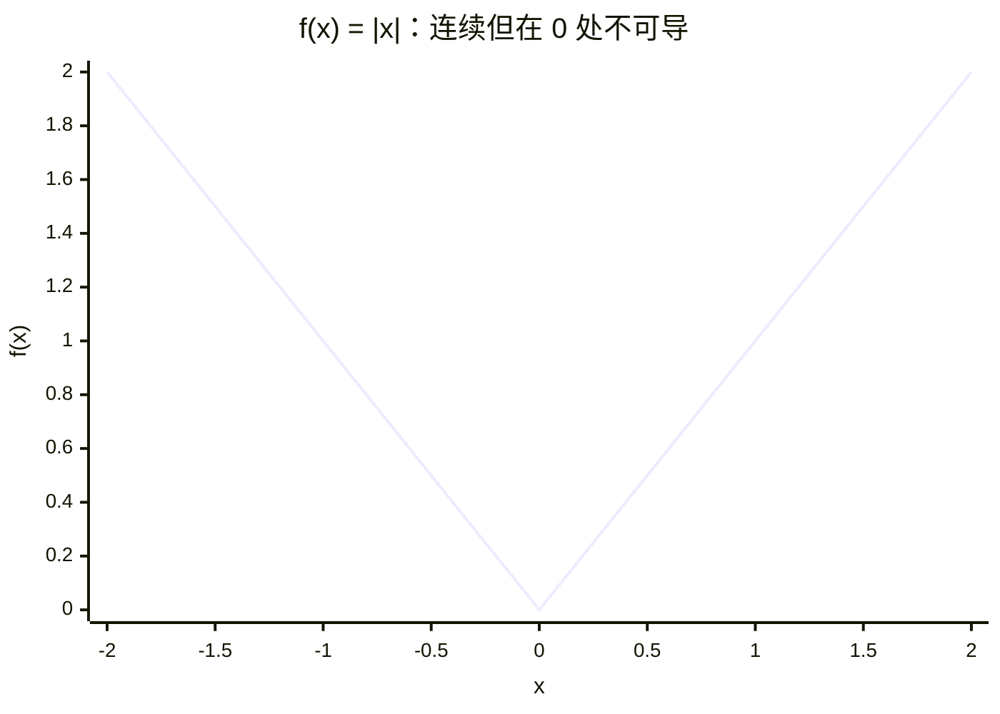
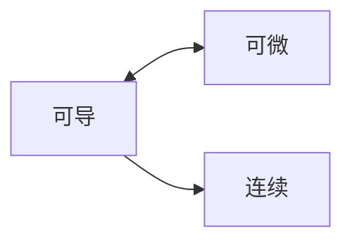

# 高数 Part 2｜导数（Derivative）与微分（Differential）知识主干

> [!info] 使用说明
> 本文放第二章可复习的定义、条件和结论；证明、原题、试算与疑点见 [[MATH-P2-Exercises]]。第一章函数、极限、连续见 [[MATH-P1-Knowledge]]。原图 `CCS-part3.zip` 与 `CCS-part3-draft.zip` 的 `part3` 只表示第三次上传，本章电子笔记为 P2。

> [!info] 证据范围
> 已核对本次 6 页笔记、12 页草稿，并用 [DeepSeek 分享对话](https://chat.deepseek.com/share/vjjt4k5pb5e5p0pypl) 核对用户提问与明确自述。以下结论依手稿与独立演算整理；未逐页核对《高等数学·基础篇》的版次、页码。对话中识图误判和不严谨说法已按定义更正，不能当作用户错误。

## 1. 导数（Derivative）先是一个极限

导数（derivative）回答“在这一点附近，函数值随输入变化得有多快”。设 $f$ 在 $x_0$ 及其邻近点有定义；$h$ 是非零的自变量增量，$\Delta y=f(x_0+h)-f(x_0)$ 是实际函数增量。若有限极限存在，则

$$
f'(x_0)=\lim_{h\to0}\frac{f(x_0+h)-f(x_0)}{h}=\lim_{h\to0}\frac{\Delta y}{h}.
$$

这里的 $\Delta y/h$ 是差商（difference quotient），即两个图像点之间的割线斜率；它在每个允许的 $h\ne0$ 处有值，并不保证 $h\to0$ 时有极限。导数是**差商的有限极限**，对应一点处的切线斜率。只看分子与分母都趋于零，也不能直接判定极限等于导数：分子必须减去该点函数值，分母必须是同一个自变量增量。相关原题见 [[MATH-P2-Exercises#2. 抽象差商与单侧信息]]。

下图把“割线趋向切线”拆成判定过程。$P=(x_0,f(x_0))$ 固定，$Q_h=(x_0+h,f(x_0+h))$ 随非零增量 $h$ 靠近 $P$；图中的箭头表示推理次序，不表示点的坐标轨迹或曲线形状。

后一种情况仍可能有竖直切线；“没有有限导数”不能直接改写成“没有几何切线”。

单侧导数（one-sided derivative）分别取 $h\to0^-$ 与 $h\to0^+$。对内点，$f'(x_0)$ 存在，当且仅当两侧导数作为有限值都存在且相等。分段点尤其要用同一个 $f(x_0)$ 写差商；仅把两侧表达式分别求导再代入，可能忽略函数值不连续。对比例题见 [[MATH-P2-Exercises#1. 分段点为什么同样不可导]]。

对含绝对值的分段点也要回到定义。若 $\psi$ 在 $a$ 连续，$g(x)=\psi(x)|x-a|$，则 $g$ 在 $a$ 可导当且仅当 $\psi(a)=0$，此时 $g'(a)=0$。这里连续性是关键前提；证明见 [[MATH-P2-Exercises#1. 分段点为什么同样不可导]]。

### 1.1 可导、连续与导函数

在一点可导必在该点连续，因为 $\Delta y=h[\Delta y/h]\to0$。连续不保证可导，例如 $|x|$ 在 0 连续，但左导数 $-1$、右导数 $1$。**在一点有导数**也不保证**导函数在该点连续**；草稿的 $x^2\sin(1/x)$ 反例见 [[MATH-P2-Exercises#4. 可导但导函数不连续]]。

下面用 $f(x)=|x|$ 的函数图像观察 $x=0$ 处的尖角。横轴从 $-2$ 到 $2$ 等距取 $-2,-1,0,1,2$，对应函数值为 $2,1,0,1,2$。本例在 $0$ 两侧分别是直线，按这些点连线可准确表示所示区间内的图形；图像帮助识别疑点，可导性仍须用左右差商验证。

图中的两段斜率分别为 $-1$、$1$，所以左导数与右导数不相等。Mermaid XY 图由给定数值连线；遇到空心端点、跳跃、渐近线或一般曲线时，不能仅靠这样的折线图判定极限与连续性。

在一元函数的内点，三者关系可以压缩为下图；箭头仅表示逻辑蕴含，不表示曲线形状。

反向从“连续”到“可导”不成立，$f(x)=|x|$ 在 $x=0$ 就是反例；“可导当且仅当可微”的证明见 [[MATH-P2-Exercises#5. 可导与可微的双向证明]]。

## 2. 微分（Differential）是局部线性部分

微分（differential）用于用一条局部直线估计曲线的真实增量。在一元函数的内点 $x_0$，若存在常数 $A$，使

$$
\Delta y=A\Delta x+o(\Delta x)\qquad(\Delta x\to0),
$$

就称 $f$ 在 $x_0$ 可微；$o(\Delta x)$ 表示除以 $\Delta x$ 后趋于 0 的误差。令 $dx=\Delta x$，$dy=A\,dx$。一元函数在该点**可微当且仅当可导**，且 $A=f'(x_0)$，故 $dy=f'(x_0)dx$。$dy$ 是线性主部，不是通常意义下与 $\Delta y$ 完全相等；二者相差 $o(\Delta x)$。也不要把 $dy/dx$ 的形式与多元函数的偏导符号 $\partial$ 混淆。双向证明见 [[MATH-P2-Exercises#5. 可导与可微的双向证明]]。

几何上，过 $(x_0,f(x_0))$ 的切线满足 $y-f(x_0)=f'(x_0)(x-x_0)$。若 $f'(x_0)\ne0$，法线斜率为 $-1/f'(x_0)$；若切线水平，法线为 $x=x_0$。切线近似解释了 $\Delta y\approx dy$，但近似只针对 $\Delta x\to0$。

## 3. 求导法则（Differentiation Rules）

下列公式在涉及的函数可导、分母非零、复合式有定义时使用。$u,v$ 是 $x$ 的函数，$c$ 为常数：

$$
(u\pm v)'=u'\pm v',\quad(cu)'=cu',\quad(uv)'=u'v+uv',\quad
\left(\frac uv\right)'=\frac{u'v-uv'}{v^2}\ (v\ne0).
$$

链式法则（chain rule）说的是“外层的变化率乘内层的变化率”：若 $y=F(u)$、$u=g(x)$，且相应点可导，则 $y'=F'(g(x))g'(x)$。复合多层时逐层相乘。草稿的 $\cos(f(x^2))$ 二阶求导见 [[MATH-P2-Exercises#9. 复合函数二阶求导与识图纠错]]。

常用初等导数（elementary derivatives）在各自定义域的内点成立。$a>0,a\ne1$；一般实数指数 $\alpha$ 的 $x^\alpha$ 先取 $x>0$：

| 函数 | 导数 | 条件或边界 |
|---|---|---|
| $x^\alpha$ | $\alpha x^{\alpha-1}$ | $x>0$ 保证任意实数 $\alpha$ 有定义；整数幂可按自身定义域扩展 |
| $e^x$, $a^x$ | $e^x$, $a^x\ln a$ | 指数底数条件如上 |
| $\ln x$, $\log_a x$ | $1/x$, $1/(x\ln a)$ | $x>0$；$\ln|x|$ 在 $x\ne0$ 的导数也为 $1/x$ |
| $\sin x$, $\cos x$ | $\cos x$, $-\sin x$ | 全体实数 |
| $\tan x$, $\cot x$ | $\sec^2x$, $-\csc^2x$ | 原函数有定义处 |
| $\arcsin x$, $\arccos x$ | $1/\sqrt{1-x^2}$, $-1/\sqrt{1-x^2}$ | $|x|<1$ |
| $\arctan x$, $\operatorname{arccot}x$ | $1/(1+x^2)$, $-1/(1+x^2)$ | $\operatorname{arccot}$ 采用值域 $(0,\pi)$ 的约定 |

### 3.1 对数求导（Logarithmic Differentiation）

当 $y>0$ 且写成乘积、商或幂指式时，先对 $\ln y$ 求导可减少展开。链式法则给出 $(\ln y)'=y'/y$，它是普通一元导数，不是偏导。若 $y=(1+\sin x)^x$，需先在 $1+\sin x>0$ 的区间操作；原题计算见 [[MATH-P2-Exercises#7. 对数求导与微分]]。

### 3.2 反函数（Inverse Function）、隐函数（Implicit Function）与参数方程（Parametric Equation）

若 $f$ 在相应局部区间严格单调、可导且 $f'(x_0)\ne0$，则反函数在 $y_0=f(x_0)$ 处有 $(f^{-1})'(y_0)=1/f'(x_0)$。分母为零时不能直接套倒数。

对 $F(x,y)=0$ 的一条局部可微分支 $y=y(x)$，若 $F$ 在点附近具有连续偏导数（partial derivative）且 $F_y\ne0$，则

$$
F_x+F_y y'=0,\qquad y'=-\frac{F_x}{F_y}.
$$

$F_x,F_y$ 是把另一个变量暂作常数求得的偏导；$y'$ 是沿分支对 $x$ 的普通导数。$F_y=0$ 时不能用该式断定不存在切线，可考虑改以 $y$ 作自变量。见 [[MATH-P2-Exercises#8. 隐函数、分支和切线]]。

若 $x=\varphi(t),y=\psi(t)$，且 $\varphi'(t)\ne0$，则

$$
\frac{dy}{dx}=\frac{\psi'(t)}{\varphi'(t)},\qquad
\frac{d^2y}{dx^2}=\frac{\frac d{dt}\left(\frac{\psi'(t)}{\varphi'(t)}\right)}{\varphi'(t)}.
$$

第二式的目标仍是“对 $x$ 再求一次导”；中途先对 $t$ 求导，是因为一阶导数由 $t$ 表示。推导及两道原题见 [[MATH-P2-Exercises#10. 参数方程二阶导数]]。

## 4. 高阶导数（Higher Derivative）

高阶导数（higher derivative）是连续对同一个自变量求导：$f''=(f')'$、$f^{(n)}=(f^{(n-1)})'$。求 $n$ 阶必须有相应阶数的导数；不能因低阶存在就默认所有高阶存在。

莱布尼茨公式（Leibniz formula）把乘积 $uv$ 的 $n$ 次求导分配给两个因子：

$$
(uv)^{(n)}=\sum_{k=0}^{n}\binom nk u^{(k)}v^{(n-k)},\qquad
\binom nk=\frac{n!}{k!(n-k)!}.
$$

这里 $\binom nk$ 是从 $n$ 次求导中选 $k$ 次落在 $u$ 上的组合数；同类项的出现次数决定系数，并非排列数。例题见 [[MATH-P2-Exercises#11. 莱布尼茨公式与组合数]]。

组合数（combination）$\binom nk=n!/[k!(n-k)!]$ 只关心选出哪 $k$ 次；排列数（permutation）$A_n^k=n!/(n-k)!$ 还区分这 $k$ 次的顺序。规定 $0!=1$。例如对 $x^2 2^x$ 求 $n$ 阶时，选择恰好两次落在 $x^2$ 上只需要 $\binom n2$，不需要排列数。

三角函数的高阶导数按四阶循环：$\frac{d^n}{dx^n}\sin x=\sin(x+n\pi/2)$，$\frac{d^n}{dx^n}\cos x=\cos(x+n\pi/2)$，$n$ 为非负整数。若 $f$ 在对称区间可导，偶函数的导函数为奇函数，奇函数的导函数为偶函数；若 $f$ 在平移 $T$ 后仍有定义、满足 $f(x+T)=f(x)$ 且两侧均可导，则 $f'(x+T)=f'(x)$。这些性质不能越过可导性与定义域条件直接使用。

## 5. 差商（Difference Quotient）判别与曲率（Curvature）的边界

对称差商（symmetric difference quotient）$[f(a+h)-f(a-h)]/(2h)$ 即使有有限极限，也不保证 $f'(a)$ 存在；$f(x)=|x|$ 在 $a=0$ 就给出反例。若左右导数都存在，它等于两者的平均值；**反过来不能由平均值存在推出两侧各自存在**。对话中的这一辨析和单侧换元题见 [[MATH-P2-Exercises#2. 抽象差商与单侧信息]]。

本批草稿末页另有曲率（curvature）与曲率半径（radius of curvature）题。若曲线在点附近可写成二次可导的 $y=y(x)$，则 $\kappa=|y''|/(1+y'^2)^{3/2}$；若更适合写成二次可导的 $x=x(y)$，可用 $\kappa=|x''(y)|/[1+x'(y)^2]^{3/2}$。当 $\kappa>0$ 时 $\rho=1/\kappa$。曲率属于几何曲线，选取哪个局部坐标表达不改变其值；选择表达式须先核对相应导数是否存在。草稿的竖直切线题见 [[MATH-P2-Exercises#12. 曲率题的几何重建]]。
