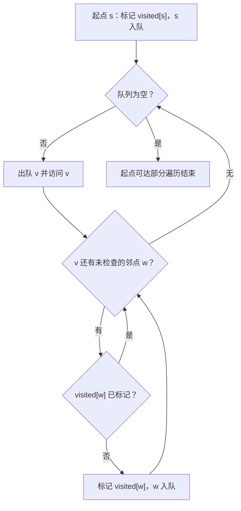
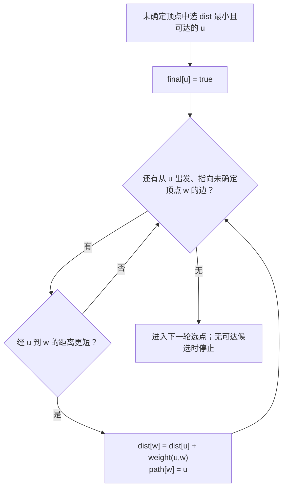
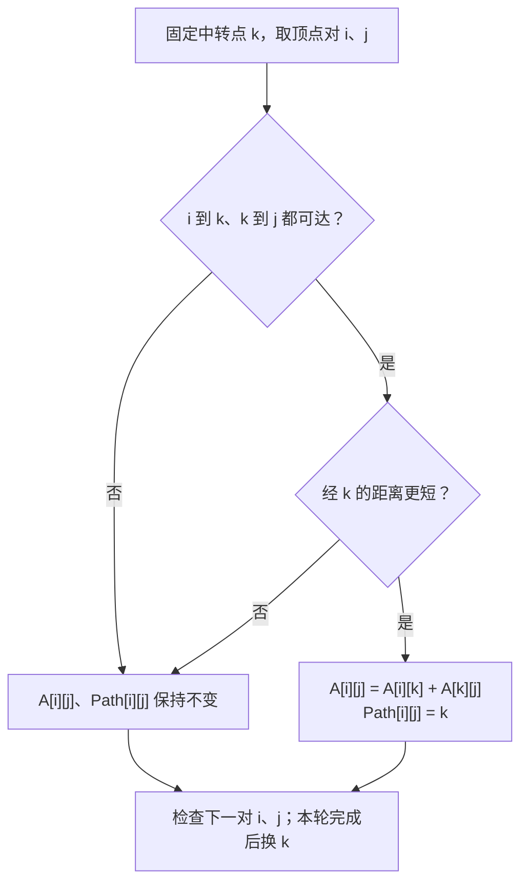

# 数据结构 P2｜第 5–6 章：树与图｜代码与习题

**知识主干：** [[DS-P2-Knowledge]]；**前章练习：** [[DS-P1-Code-Exercises]]。下文 C 代码为参考片段。

## 1. 层序遍历：队列保持待访问顺序

草稿先把根结点入队，再反复出队、访问，并将存在的左、右孩子依次入队。队列让同层先入队的结点先处理；若左右孩子的入队次序改变，输出也会改变。

```c
// TreeNode、Queue、enqueue、dequeue、queue_empty、visit 由题目定义。
void level_order(TreeNode *root, Queue *q) {
    if (root == NULL) return;
    enqueue(q, root);
    while (!queue_empty(q)) {
        TreeNode *p = dequeue(q);
        visit(p);
        if (p->lchild != NULL) enqueue(q, p->lchild);
        if (p->rchild != NULL) enqueue(q, p->rchild);
    }
}
```

手推时把「队列内容、出队结点、输出」并列记录，先固定最终树形再求序列。

## 2. 中序线索化：`pre` 是刚访问过的结点

手稿中的 `pre` 和当前结点 `q` 围绕一个不变量：**中序处理 `q` 时，`pre` 是此前刚访问过的结点**。若 `q` 原本没有左孩子，可将左指针设为指向 `pre` 的前驱线索；若 `pre` 没有右孩子，可让它的右指针指向 `q`。处理完再令 `pre=q`。

```c
// 参考片段：ltag/rtag 为 0 表示孩子，为 1 表示线索。
void in_thread(ThreadNode *q, ThreadNode **pre) {
    if (q == NULL) return;
    if (q->ltag == 0) in_thread(q->lchild, pre);
    if (q->lchild == NULL) {
        q->lchild = *pre;
        q->ltag = 1;
    }
    if (*pre != NULL && (*pre)->rchild == NULL) {
        (*pre)->rchild = q;
        (*pre)->rtag = 1;
    }
    *pre = q;
    if (q->rtag == 0) in_thread(q->rchild, pre);
}
```

递归只能进入原本的孩子，不能沿线索再次下降。首结点的前驱和末结点的后继取决于是否设置头结点；不把手稿中的多个试写分支合成一个未经题设确认的完整函数。

## 3. 树与森林：孩子和兄弟是两类连接

孩子兄弟表示法把一个结点的第一个孩子放在左指针方向，把下一个兄弟放在右指针方向。画转换图时逐个核对这两种关系；不能把“右指针”一律看成原树中的右孩子。

## 4. 并查集：根的标记决定 `Find` 的终止条件

草稿中的 `Find` 沿 `parent` 追到集合代表；其 `parent[x] >= 0` 条件建立在「根位置存负值，非根位置存父结点下标」的约定上。`Union` 先分别找根，根不同才连接。若换了根的初始化约定，不能照抄该终止条件。这里没有把路径压缩或按秩合并写成用户已实现的代码。

## 5. 图的存储与邻接操作

原图同时画邻接矩阵、邻接表以及十字链表等结构。`Adjacent(G,x,y)` 要回答两顶点是否相邻；`Neighbors(G,x)` 列出 x 的邻接点。对邻接矩阵，逐列检查第 x 行；对邻接表，沿 x 的首边指针向后遍历。链结点指针与该结点保存的顶点编号是两回事：比较邻接点时取结点中的编号，推进遍历时移动指针。

`Adjacent` 按调用者已传入有效顶点下标讨论；矩阵扫描的上界是顶点数 `n`。具体函数签名与返回类型由题目接口决定。

图的边方向也影响邻接结果：有向图邻接表从 x 的首边出发，通常枚举的是 x 的出边；十字链表要区分出边链与入边链。

## 6. BFS：入队时标记，邻接次序决定具体序列

草稿中队列保存待扩展顶点，`visited` 防止重复入队。起点被发现后先标记并入队；每次取出一个顶点，按题目规定的邻接顺序发现尚未访问的邻接点。**入队时就标记**，避免同一顶点被多个前驱重复加入。

下图中的 `v` 是本轮出队顶点，`w` 是正在检查的邻点。箭头表示队列与访问标记的状态变化，邻点的实际枚举顺序仍由题目决定。



```c
// Graph、IntQueue、first_neighbor、next_neighbor 等由具体存储实现提供。
void bfs(const Graph *g, int s, bool visited[], IntQueue *q) {
    visited[s] = true;
    enqueue_int(q, s);
    while (!int_queue_empty(q)) {
        int v = dequeue_int(q);
        visit_vertex(v);
        for (int w = first_neighbor(g, v); w != -1;
             w = next_neighbor(g, v, w)) {
            if (visited[w]) continue;
            visited[w] = true;
            enqueue_int(q, w);
        }
    }
}
```

一次从起点开始只覆盖其可达部分；遍历非连通图的全部顶点时，外层需从每个尚未访问的顶点再启动一次。若题目没有固定邻接枚举次序，BFS 的访问序列未必唯一。

## 7. 无权最短路径：首次发现时写距离与前驱

无权图中 BFS 按边数从少到多扩展。原图的 `len` 存从起点到顶点的边数，`path` 存首次发现该顶点时的前驱**顶点下标**；显示在图上的顶点编号和数组下标须先按题目映射。起点 `len=0`，每次发现 `w` 时令 `len[w]=len[v]+1`、`path[w]=v`，未到达的结点保持未访问标记。

```c
// len == -1 表示尚未到达；path 存前驱下标。
void bfs_shortest(const Graph *g, int s, int n,
                  int len[], int path[], IntQueue *q) {
    for (int i = 0; i < n; ++i) {
        len[i] = -1;
        path[i] = -1;
    }
    len[s] = 0;
    enqueue_int(q, s);
    while (!int_queue_empty(q)) {
        int v = dequeue_int(q);
        for (int w = first_neighbor(g, v); w != -1;
             w = next_neighbor(g, v, w)) {
            if (len[w] != -1) continue;
            len[w] = len[v] + 1;
            path[w] = v;
            enqueue_int(q, w);
        }
    }
}
```

回溯路线时从终点沿 `path` 走到起点，再反转为正向序列。

## 8. Dijkstra：先选点，再确定，再松弛

带权图草稿同时维护 `final`、`dist`、`path`：分别表示最短距离是否已确定、当前候选距离、该候选路线的前驱下标。每轮从未确定顶点中选 `dist` 最小的顶点 `u`，再令 `final[u]=true`，然后尝试通过 `u` 缩短其邻接点的距离；更新距离时同步更新前驱。

状态按以下次序改变；图中 `u`、`w` 代表顶点下标，`weight(u,w)` 代表边权，没有代入手稿中被改动的边权表。



`final[u]` 只在选出 `u` 后改变；`dist[w]` 与 `path[w]` 则只在松弛成功时一起改变。数值推演应另按题目逐轮填写 `final/dist/path` 表。

> [!danger] 我的错误（已证实）
> 原图把选点之前的 `final[u]=true` 划掉了；此时还没有选出本轮顶点。下方循环虽先求得 `nex`，却又写了 `final[i]=true`，其中 `i` 是外层轮次变量，`nex` 才是本轮选中的顶点。应在确认 `nex` 有效且可达后写 `final[nex]=true`，再松弛从 `nex` 出发的边。

该算法要求边权非负。若未选顶点的最小候选距离仍是无穷大，其余顶点从起点不可达，算法可停止。

## 9. Floyd：距离矩阵与中转点矩阵同步更新

草稿按中转点 `k` 检查每对 `i,j`：若 `A[i][k]+A[k][j]` 更短，就更新 `A[i][j]`。这套笔记的 `Path[i][j]` 采用**中转点下标**约定，更新时记录 `k`；它不是显示在图上的结点名称，也不是 Dijkstra 的前驱数组。

每轮固定一个中转点 `k`，对所有有序顶点对 `(i,j)` 检查下图的状态变化；图中不代入手稿中反复修改的矩阵数值。



`A[i][j]` 是距离，`Path[i][j]` 是用于复原该路线的中转点下标；两者只在候选路线更短时同步改动。逐轮矩阵数值应按原题边权另行核对。

$$
A[i][j]\leftarrow\min\{A[i][j], A[i][k]+A[k][j]\}.
$$

若 `Path[i][j]=k`，复原路线时先展开 `(i,k)`，再展开 `(k,j)`；连接处的 `k` 只输出一次。若为 `-1`，还须区分直达、同点与不可达。原图中的递归树正是在拆分这些子问题，但具体矩阵数字和输出顺序多次修改，因此不将其认作固定答案。求和前还须避免把无穷大哨兵当作普通边权参与加法。

## 10. 最小生成树与有向无环图的手推入口

- Prim：维护已选顶点集合；每轮选连接集合内外的最小权边，加入新顶点。
- Kruskal：按边权从小到大检查；只加入不会形成环的边。连通图最终选出 $|V|-1$ 条边。
- 拓扑排序：反复选择入度为 $0$ 的顶点，输出并删除其出边；若仍有顶点却找不到入度为 $0$ 者，说明存在有向环。

拓扑排序可按以下顺序实现：先把零入度顶点入队；每出队一个顶点就输出它，并逐条处理其出边，把入度因此降为零的后继入队。这样队列中的顶点始终满足「尚未输出且当前入度为零」。若输出数少于顶点数，说明存在环。关键路径的计算须依赖 AOE 网的完整边权。
