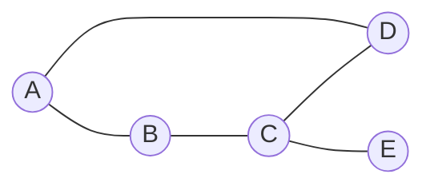
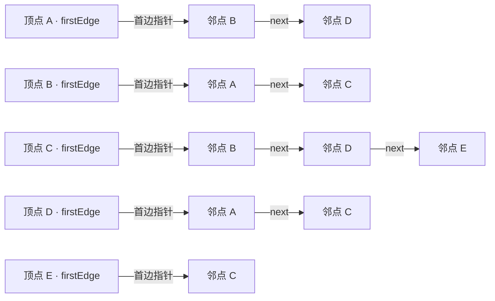
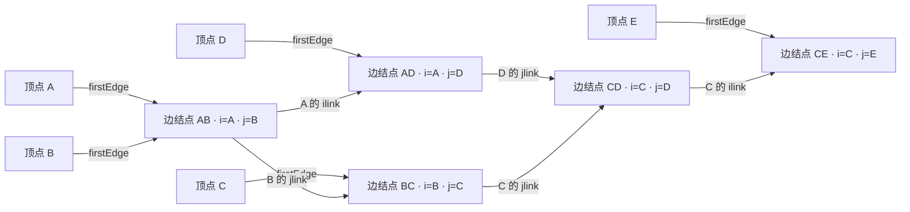
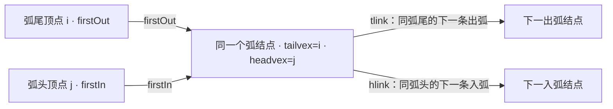

# 数据结构 P2｜第 5–6 章：树与图｜知识主干

**推导与代码：** [[DS-P2-Code-Exercises]]；**前后章节：** [[DS-P1-Knowledge]]、[[DS-P3-Knowledge]]。

## 1. 树（Tree）与二叉树（Binary Tree）

### 1.1 树（Tree）的基本概念

常见概念：

- 根结点（root node）
- 父结点（parent node）/ 子结点（child node）
- 兄弟结点（sibling nodes）
- 叶子结点（leaf node）
- 结点的度（node degree）
- 树的度（tree degree）
- 层次（level）
- 高度（height）/ 深度（depth）

树中：

$$
n = e + 1
$$

其中 $n$ 为结点数，$e$ 为边数。

### 1.2 m 叉树（m-ary Tree）的常见结论

第 $i$ 层最多：

$$
m^{i-1}
$$

个结点。

当 $m\ge2$，高度为 $h$ 时最多：

$$
1+m+m^2+\cdots+m^{h-1}
=
\frac{m^h-1}{m-1}
$$

个结点。

### 1.3 二叉树（Binary Tree）性质

非空二叉树中：

$$
n_0=n_2+1
$$

其中：

- $n_0$：叶子结点数
- $n_2$：度为 2 的结点数

这些名称回答的问题不同，可从形状、遍历辅助、关键字次序和平衡约束四个维度比较；同一棵二叉树可以同时具有其中几种性质。

| 维度 | 类型 | 判断依据与作用 |
|---|---|---|
| 形状 | 满二叉树（perfect binary tree） | 每层结点数都达到该层最大值 |
| 形状 | 完全二叉树（complete binary tree） | 按层从左到右编号时，与同高度满二叉树的前若干编号对应；最后一层结点靠左连续排列 |
| 遍历辅助 | 线索二叉树（threaded binary tree） | 利用原本为空的孩子指针记录特定遍历次序下的前驱或后继，仍须看标志位区分孩子与线索；见下文“线索二叉树” |
| 关键字次序 | 二叉排序树（binary search tree, BST） | 左子树关键字小于根、右子树关键字大于根；见 [[DS-P3-Knowledge#3. 二叉排序树（BST）|P3 的二叉排序树]] |
| 平衡约束 | AVL 树、红黑树 | 都保持 BST 的关键字次序，分别用高度差或颜色规则约束树高；见 [[DS-P3-Knowledge#4. 平衡二叉树（AVL）与红黑树|P3 的平衡查找树]] |

满二叉树一定是完全二叉树；“线索化”说明指针的用途，不决定这棵树是否满、完全或满足 BST 次序。B 树与 B+ 树是 [[DS-P3-Knowledge#5. B 树与 B+ 树|多路查找树]]，不属于二叉树的形状分类。

层序遍历的队列推演见 [[DS-P2-Code-Exercises#1. 层序遍历：队列保持待访问顺序]]。

---

## 2. 二叉树遍历（Binary Tree Traversal）、线索二叉树（Threaded Binary Tree）、树（Tree）与森林（Forest）

### 2.1 遍历（Traversal）

| 遍历方式 | 访问顺序 |
|---|---|
| 前序遍历（preorder traversal） | 根 → 左 → 右 |
| 中序遍历（inorder traversal） | 左 → 根 → 右 |
| 后序遍历（postorder traversal） | 左 → 右 → 根 |
| 层序遍历（level-order traversal） | 按层访问 |

记忆法：

> 前、中、后，说的是“根”的访问位置。

接到 [[DS-P3-Knowledge#3. 二叉排序树（BST）|二叉排序树]] 时，中序遍历会按关键字升序访问；AVL 旋转也必须保持这个次序。中序线索记录的则是**中序访问关系**，不能仅凭“有线索”推断关键字有序。

### 2.2 线索二叉树（Threaded Binary Tree）

常见结点结构：

```c
typedef struct ThreadNode {
    ElemType data;
    struct ThreadNode *lchild, *rchild;
    int ltag, rtag;
} ThreadNode;
```

标志位：

```text
tag = 0 → 指向孩子
tag = 1 → 指向线索
```

线索用于记录：

- 前驱（predecessor）
- 后继（successor）

### 2.3 树（Tree）与森林（Forest）的表示

- 双亲表示法（parent representation）
- 孩子表示法（child-list representation）
- 孩子兄弟表示法（left-child right-sibling representation）

孩子兄弟表示法核心：

```text
data | firstChild | nextSibling
```

---

## 3. 哈夫曼树（Huffman Tree）

带权路径长度（weighted path length, WPL）：

$$
WPL=\sum_{i=1}^{n}w_i l_i
$$

哈夫曼树的目标：使 WPL 最小。

它与 [[DS-P3-Knowledge#1. 查找的对象与代价|平均查找长度 ASL]] 都用权重和路径代价讨论总体成本；WPL 中的 $l_i$ 是叶结点路径长度，ASL 中的 $C_i$ 是按具体查找规则统计的比较次数。两者计数口径与树的约束不同，不能直接将 WPL 当成 ASL。

构造过程：

```text
取权值最小的两个结点
        ↓
合并为新结点
        ↓
新权值 = 两者之和
        ↓
重新加入集合
        ↓
重复
```

---

## 4. 图（Graph）

### 4.1 图（Graph）的基本定义

$$
G=(V,E)
$$

- $V$：顶点（vertex）集合
- $E$：边（edge）集合

常见概念：

- 有向图（directed graph）/ 无向图（undirected graph）
- 简单图（simple graph）/ 多重图（multigraph）
- 完全图（complete graph）
- 子图（subgraph）
- 连通图（connected graph）
- 强连通图（strongly connected graph）
- 连通分量（connected component）
- 强连通分量（strongly connected component）
- 度（degree）/ 入度（in-degree）/ 出度（out-degree）

无向图：

$$
\sum_{v\in V}D(v)=2|E|
$$

有向图：

$$
\sum ID(v)=\sum OD(v)=|E|
$$

### 4.2 图（Graph）的存储

四种结构先按「适合什么图、解决什么问题、结点怎样组织」串起来：

| 结构 | 常见适用场景 | 主要解决的问题 | C 结构中的关键特征 |
|---|---|---|---|
| 邻接矩阵 | 稠密图 | 判断两顶点是否有边可直接访问，$O(1)$ | 二维数组 `edge[i][j]` |
| 邻接表 | 稀疏图，也可通用 | 按顶点的邻居链遍历，节省稀疏图的空间 | 顶点数组 + 每个顶点的一条单链表 |
| 十字链表 | 有向图 | 同时沿出弧链和入弧链访问，便于求入度 | 顶点有 `firstIn` / `firstOut`；弧有 `hlink` / `tlink` |
| 邻接多重表 | 无向图 | 一条边只存一次，删边时可从两端点的链维护它 | 边结点有 `ivex` / `jvex`、`ilink` / `jlink` |

这里的场景是选型倾向，并非使用限制。邻接表枚举一个顶点的邻居只需遍历它的链；若要判断某个**指定邻点**是否在链中，仍需逐结点查找。

手稿中的无向图有顶点 `A、B、C、D、E`，边为 `AB、AD、BC、CD、CE`。下面按这组顶点和边构造邻接矩阵、邻接表与邻接多重表；图中没有给这五条边设权值。



#### 邻接矩阵（adjacency matrix）

行是起点、列是终点，`1` 表示有边，`0` 表示无边。无向边对应两个对称位置；这张图没有自环，主对角线均为 `0`。

```c
// 参考结构：顶点 A～E 对应下标 0～4。
typedef struct MatrixGraph {
    char vertex[5]; // 顶点表
    int edge[5][5]; // edge[i][j]：顶点 i 与 j 是否相邻
} MatrixGraph;
```

| 行 \ 列 | A | B | C | D | E |
|---|---:|---:|---:|---:|---:|
| A | 0 | 1 | 0 | 1 | 0 |
| B | 1 | 0 | 1 | 0 | 0 |
| C | 0 | 1 | 0 | 1 | 1 |
| D | 1 | 0 | 1 | 0 | 0 |
| E | 0 | 0 | 1 | 0 | 0 |

矩阵行、列顺序固定为 `A、B、C、D、E`。例如 `M[A,D]=M[D,A]=1` 对应无向边 `AD`，`M[A,C]=0` 表示两者没有直接相连。

#### 邻接表（adjacency list）

```c
// 参考结构：顶点 A～E 对应下标 0～4。
typedef struct ALArcNode {
    int adjvex;              // 邻点的下标；不是 next 指针
    struct ALArcNode *next;  // 同一顶点的下一条边表结点
} ALArcNode;

typedef struct ALVertexNode {
    char data;               // 顶点名称，如 A
    ALArcNode *firstEdge;    // 当前顶点的第一条边表结点
} ALVertexNode;
```

下图的箭头**全是存储指针**：箭头的目标是边表结点，边表结点内的字母才是邻点。



无向边在两个顶点的链中各出现一次，例如 `AB` 对应 `A` 链中的邻点 `B` 与 `B` 链中的邻点 `A`。链尾的 `next` 为 `NULL`；链结点排列次序可以改变，但邻接集合不能改变。

#### 邻接多重表（adjacency multilist）

这仍表示上面的**无向图**，每条无向边只存一个边结点。

```c
// 参考结构：同一个边结点由两端点的链共享。
typedef struct AMEdgeNode {
    int ivex, jvex;            // 无向边的两个端点下标
    struct AMEdgeNode *ilink;  // 沿 ivex 所在链的下一条边
    struct AMEdgeNode *jlink;  // 沿 jvex 所在链的下一条边
    // 若题目需要边信息，再增加 info 字段。
} AMEdgeNode;

typedef struct AMVertexNode {
    char data;                 // 顶点名称，如 A
    AMEdgeNode *firstEdge;    // 当前顶点的第一条关联边
} AMVertexNode;
```

下图把同一条边结点从两端点的链中共享；箭头表示 `firstEdge` 或 `ilink/jlink` 指针，**不表示图中边的方向**。



例如沿 `A.firstEdge` 到 `AB`，因为 `A` 是 `AB` 的 `i` 端，下一步沿 `ilink` 到 `AD`；沿 `B.firstEdge` 到同一个 `AB`，因为 `B` 是 `j` 端，下一步沿 `jlink` 到 `BC`。其余未画出的链尾指针为 `NULL`。每走到边结点，都要先判断当前顶点是 `i` 端还是 `j` 端，再选对应的后继指针。

#### 十字链表（orthogonal list）

手稿只给出了**有向图**十字链表的结点格式，没有一张可逐边核对的完整有向图，因此下图只画字段与链接规则。

```c
// 参考结构：一条有向弧只存一个弧结点。
typedef struct OLArcNode {
    int headvex;             // 弧头下标 j
    int tailvex;             // 弧尾下标 i；实际弧方向为 i -> j
    struct OLArcNode *hlink; // 同一弧头的下一条入弧
    struct OLArcNode *tlink; // 同一弧尾的下一条出弧
    // 若题目需要边权，再增加 weight 字段。
} OLArcNode;

typedef struct OLVertexNode {
    char data;              // 顶点名称
    OLArcNode *firstIn;     // 指向第一条入弧
    OLArcNode *firstOut;    // 指向第一条出弧
} OLVertexNode;
```



沿 `i.firstOut` 和各弧结点的 `tlink` 枚举从 `i` 发出的弧；沿 `j.firstIn` 和各弧结点的 `hlink` 枚举指向 `j` 的弧。图中两条首指针可能落在同一个弧结点，表示一条有向弧同时属于弧尾的出弧链与弧头的入弧链；图中指针箭头不等于这条弧本身的方向。

### 4.3 图（Graph）的遍历（Traversal）

**广度优先搜索（Breadth-First Search, BFS）**

- 常借助队列
- 按层扩展

**深度优先搜索（Depth-First Search, DFS）**

- 常借助递归或栈
- 沿一条路径深入后回溯

图的存储与邻接操作见 [[DS-P2-Code-Exercises#5. 图的存储与邻接操作]]。

---

## 5. 最小生成树（Minimum Spanning Tree, MST）

### 5.1 普里姆算法（Prim's Algorithm）

普里姆算法（Prim's algorithm）从一个顶点出发，逐步扩展已选顶点集合。

记忆：

> Prim 更像“扩点”。

基本过程：

```text
从一个顶点开始
      ↓
维护已选顶点集合
      ↓
选择连接集合内外的最小权边
      ↓
加入新顶点
      ↓
直到包含全部顶点
```

### 5.2 克鲁斯卡尔算法（Kruskal's Algorithm）

克鲁斯卡尔算法（Kruskal's algorithm）按边权从小到大选边，同时避免成环。

记忆：

> Kruskal 更像“选边”。

基本过程：

```text
边按权值升序排列
      ↓
从小到大尝试加入
      ↓
若形成环则舍弃
      ↓
直到选出 n-1 条边
```

---

## 6. 最短路径（Shortest Path）

| 算法 | 主要用途 |
|---|---|
| 广度优先搜索（Breadth-First Search, BFS） | 无权图单源最短路 |
| 迪杰斯特拉算法（Dijkstra's Algorithm） | 非负权图单源最短路 |
| 弗洛伊德算法（Floyd–Warshall Algorithm） | 各顶点之间最短路 |

队列、候选距离和距离矩阵的状态变化分别见 [[DS-P2-Code-Exercises#6. BFS：入队时标记，邻接次序决定具体序列|BFS 过程]]、[[DS-P2-Code-Exercises#8. Dijkstra：先选点，再确定，再松弛|Dijkstra 过程]]、[[DS-P2-Code-Exercises#9. Floyd：距离矩阵与中转点矩阵同步更新|Floyd 过程]]。

---

## 7. 有向无环图（Directed Acyclic Graph, DAG）、拓扑排序（Topological Sorting）与关键路径（Critical Path）

### 7.1 有向无环图（Directed Acyclic Graph, DAG）

有向无环图（directed acyclic graph, DAG）：**没有有向环的有向图**。

### 7.2 AOV 网（Activity-on-Vertex Network）

AOV 网（activity-on-vertex network）用顶点表示活动。

- 常用于描述活动之间的先后制约关系
- 与拓扑排序（topological sorting）相关

拓扑排序从当前入度为 $0$ 的顶点开始：输出顶点，删除它发出的边，再寻找新的零入度顶点，直到全部顶点输出。可用队列保存已经达到零入度的顶点。若还有未输出顶点，却找不到零入度顶点，则图中存在有向环；若同时存在多个零入度顶点，拓扑序列可能不唯一。

### 7.3 AOE 网（Activity-on-Edge Network）

AOE 网（activity-on-edge network）用边表示活动。

- 顶点常表示事件
- 与关键路径（critical path）相关

AOE 网中，活动持续时间标在边上；从源点到汇点的最长路径长度决定整个工程的最短完成时间。求关键活动时，先按拓扑序计算事件的最早发生时间，再逆拓扑序计算事件的最迟发生时间。活动的最早开始时间与最迟开始时间相等时，该活动是关键活动；关键活动构成关键路径。

---
